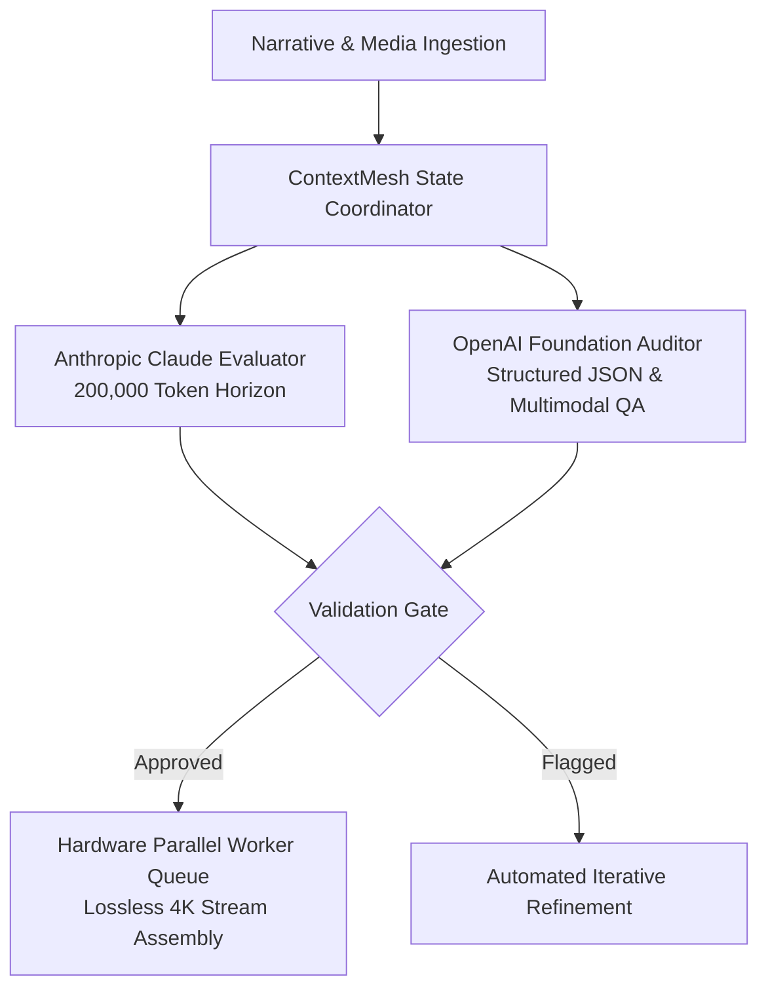

# ContextMesh Core

[](https://www.python.org/downloads/)
[](https://opensource.org/licenses/MIT)
[](https://www.anthropic.com/)
[](https://openai.com/)
[](https://gcmediastudio.com)

**ContextMesh Core** is an open-source high-horizon multi-agent orchestration engine developed by **[GC (Generative Creative) Media Studio](https://gcmediastudio.com)**. It bridges frontier cloud reasoning models (Anthropic Claude and OpenAI) with local hardware-accelerated video/audio execution pipelines.

---

## Key Architectural Capabilities



### 1. Extended Context Reasoning (Anthropic Claude)
- Harnesses Claude's **200,000-token context horizon** for long-form narrative consistency, script logic, and cross-modal story arcs without context fragmentation.
- Eliminates narrative drift across high-hour ambient media sequences and episodic dialogue.

### 2. Structured Programmatic QA (OpenAI Foundation Models)
- Strict JSON schema enforcement, function calling, and metadata compliance audits.
- Multimodal visual safe-zone inspection, teleprompter boundary tracking, and kinetic typography layout verification.

### 3. Local Workstation Dispatch & Parallel Video Rendering
- Parallel chunk worker architecture utilizing AMD Ryzen multi-core CPUs in tandem with NVIDIA hardware GPU acceleration (`nvenc`/`nvdec`).
- Lossless timeline stream copy (`-c copy`) delivering 3x–5x rendering acceleration at 4K 60fps with 0% generational loss.

---

## Installation

```bash
# Clone the repository
git clone https://github.com/gcmediastudio/contextmesh.git
cd contextmesh

# Install dependencies
pip install -e .

# Install optional frontier AI backends
pip install -e ".[ai]"
```

---

## Quickstart

```python
from contextmesh import ContextMesh, ClaudeEvaluator, OpenAIAuditor
from contextmesh.pipeline import HardwareRunner

# 1. Initialize ContextMesh
mesh = ContextMesh(project_name="Commercial-Presenter-4K")

# 2. Ingest script and narrative context
mesh.ingest_context("Scene 1: Presenter opens on virtual set, introducing applied AI architecture.")
mesh.ingest_context("Scene 2: Teleprompter scrolls kinetic typography safe-zone constraints.")
mesh.ingest_context("Scene 3: Audio transitions to 432Hz ambient rain binaural soundscape.")

print(f"Total Context Horizon: {mesh.total_context_tokens():,} tokens")

# 3. Register frontier model evaluators
claude = ClaudeEvaluator()
openai = OpenAIAuditor()

# 4. Assemble pipeline and execute multi-agent audit
result = mesh.assemble_pipeline(evaluators=[claude, openai])
print(f"Validation Result: {result.status} (Passed: {result.validation_passed})")

# 5. Dispatch hardware GPU timeline chunk rendering
runner = HardwareRunner(num_workers=4, use_nvenc=True)
manifest = runner.render_parallel_chunks({"chunks": ["scene_01", "scene_02", "scene_03"]})
print(f"Render Complete: {manifest['total_chunks_processed']} chunks in {manifest['render_time_seconds']}s")
```

Run the included example script:
```bash
python examples/quickstart.py
```

---

## Testing

Run unit tests via `unittest`:
```bash
python -m unittest discover -s tests
```

---

## License

This project is licensed under the MIT License — see the [LICENSE](LICENSE) file for details.

Engineered and maintained by **[GC (Generative Creative) Media Studio](https://gcmediastudio.com)** · `contact@gcmediastudio.com`.
